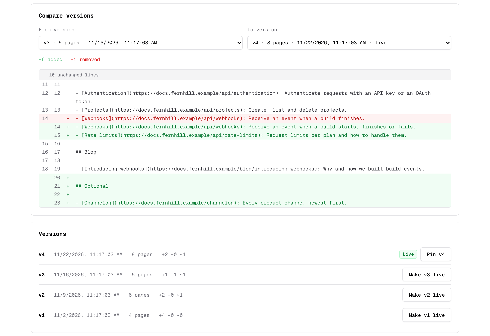
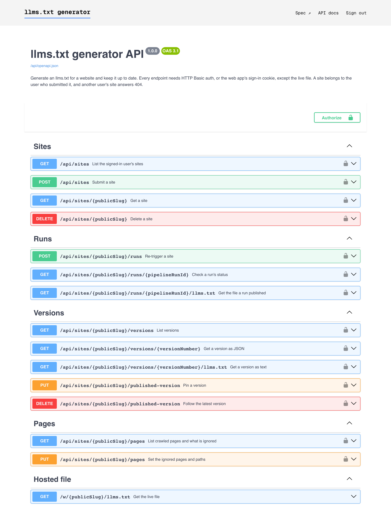

# [llms.txt](https://llmstxt.org) generator

A web app that takes a website URL, generates an llms.txt for it, and keeps it up to date as the site changes. The design is in [`docs/design/README.md`](docs/design/README.md), as diagrams.

## Quick start

Needs Docker.

```sh
LLM_CLIENT=stub docker compose up --build
```

Open <http://localhost:3000> and sign in as `user1` / `pass1`. This starts Postgres, the web app and the worker, with a provided demo site.

`LLM_CLIENT=stub` runs without a model, which lowers the output quality.

## Quick start with an `ANTHROPIC_API_KEY`

For higher quality llms.txt output:

```sh
ANTHROPIC_API_KEY=sk-ant-... docker compose up --build
```


## Deploying to Railway

1. Create the project and its database.

   ```sh
   railway login
   railway init
   railway add --database postgres
   ```

2. Create the two services with their variables. Choose your own login: the default `user1` / `pass1` is public.

   ```sh
   railway add --service web \
     --variables "SERVICE_ROLE=web" \
     --variables 'DATABASE_URL=${{Postgres.DATABASE_URL}}' \
     --variables "BASIC_AUTH_USERNAME=<username>" \
     --variables "BASIC_AUTH_PASSWORD=<password>"

   railway add --service worker \
     --variables "SERVICE_ROLE=worker" \
     --variables 'DATABASE_URL=${{Postgres.DATABASE_URL}}' \
     --variables "ANTHROPIC_API_KEY=<key>" \
     --variables "RAILWAY_DEPLOYMENT_DRAINING_SECONDS=660"
   ```

   The last variable gives a worker that is being replaced time to finish its runs.

3. Apply the schema to the empty database. This opens `psql`, which must be installed.

   ```sh
   railway connect Postgres
   \i db/schema.sql
   ```

4. Deploy both services and give the web app a public address.

   ```sh
   railway up --service web
   railway up --service worker
   railway domain --service web
   ```

## Screenshots

Sign in:


Your sites:


Site details:


User configuration:


Version selection and comparison:



REST API, available at `/api-docs`:


