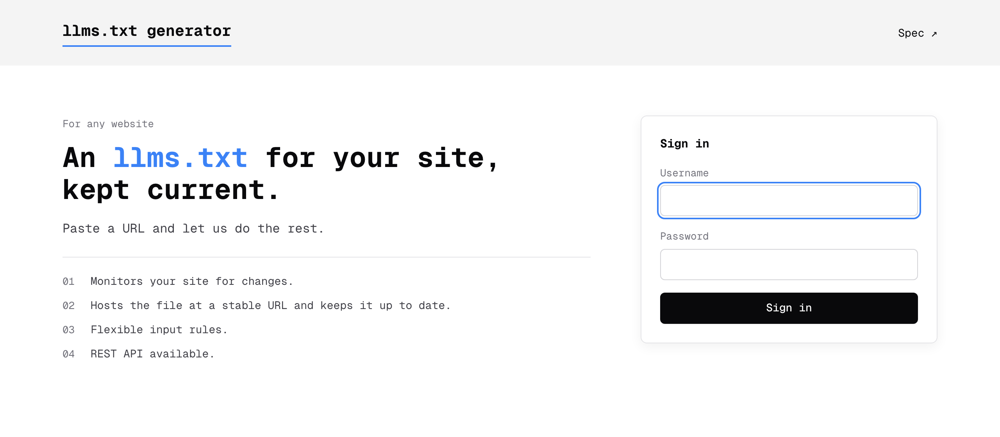
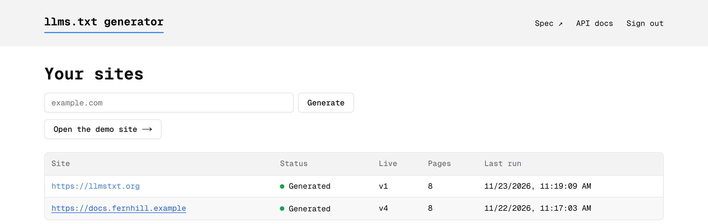
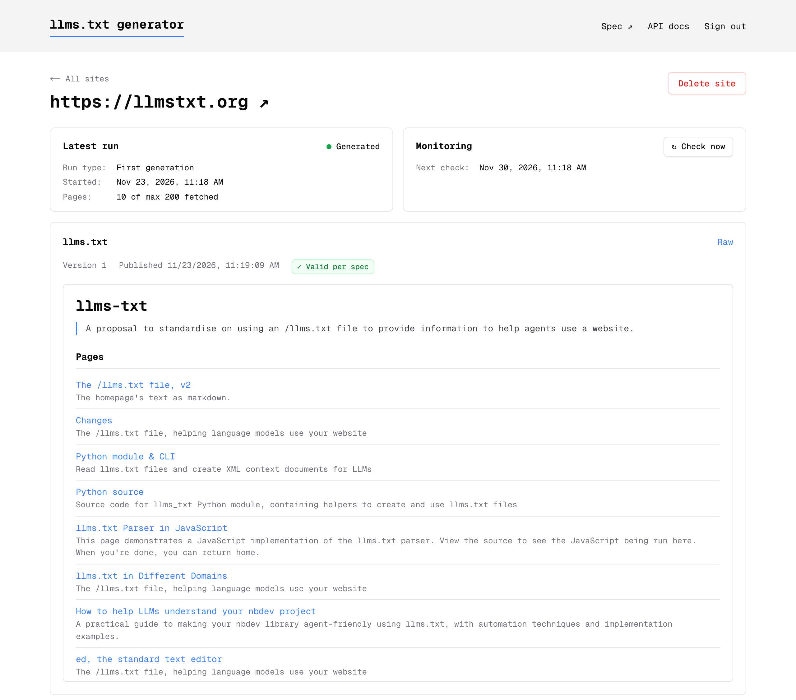
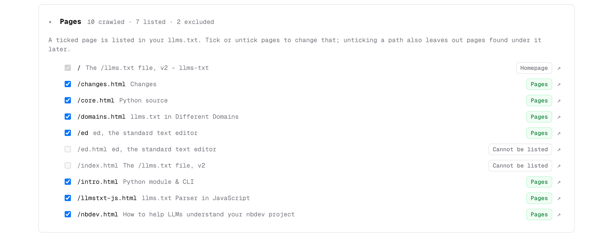

# [llms.txt](https://llmstxt.org) generator

A web app that takes a website URL, generates an llms.txt for it, and keeps it up to date as the site changes. The design is in [`docs/design/README.md`](docs/design/README.md), as diagrams.

## Quick start

Needs Docker.

```sh
LLM_CLIENT=stub docker compose up --build
```

Open <http://localhost:3000> and sign in as `user1` / `pass1`. This starts Postgres, the web app and the worker, with a demo site already there (it cannot be deleted).

`LLM_CLIENT=stub` runs without a model, so every crawled page is listed with its own meta description. It shows the app working, not the file it would really write.

## Quick start with an `ANTHROPIC_API_KEY`

```sh
ANTHROPIC_API_KEY=sk-ant-... docker compose up --build
```

Claude Haiku now decides which pages belong in the file and describes them, and Claude Opus writes the site summary. The key can also go in a `.env` file at the repository root.

## Deploying to Railway

The app is three services in one Railway project: Postgres, `web` and `worker`. Both app services build the repository's `Dockerfile`, and `SERVICE_ROLE` tells each which process to start. These steps use the [Railway CLI](https://docs.railway.com/guides/cli) from the repository root.

1. Create the project and its database.

   ```sh
   railway login
   railway init
   railway add --database postgres
   ```

2. Create the two services with their variables. Choose your own login: the default `user1` / `pass1` is public.

   ```sh
   railway add --service web \
     --variables "SERVICE_ROLE=web" \
     --variables 'DATABASE_URL=${{Postgres.DATABASE_URL}}' \
     --variables "BASIC_AUTH_USERNAME=<username>" \
     --variables "BASIC_AUTH_PASSWORD=<password>"

   railway add --service worker \
     --variables "SERVICE_ROLE=worker" \
     --variables 'DATABASE_URL=${{Postgres.DATABASE_URL}}' \
     --variables "ANTHROPIC_API_KEY=<key>" \
     --variables "RAILWAY_DEPLOYMENT_DRAINING_SECONDS=660"
   ```

   The last variable gives a worker that is being replaced time to finish its runs.

3. Apply the schema to the empty database. This opens `psql`, which must be installed.

   ```sh
   railway connect Postgres
   \i db/schema.sql
   ```

4. Deploy both services and give the web app a public address.

   ```sh
   railway up --service web
   railway up --service worker
   railway domain --service web
   ```

A deploy never changes the schema, so apply a later change to `db/schema.sql` by hand before deploying the code that needs it.

This repository also deploys both services on every merge to `main`, from the `deploy` job in `.github/workflows/ci.yml`. That needs a Railway project token in the repository secret `RAILWAY_TOKEN`.

## Screenshots

Sign in:



Your sites, and the box to submit a new one:



A site: its latest run, when it is next checked, and the generated llms.txt:



Choosing which pages the file lists:



Comparing versions and choosing which one is live:


The REST API, at `/api-docs`:


