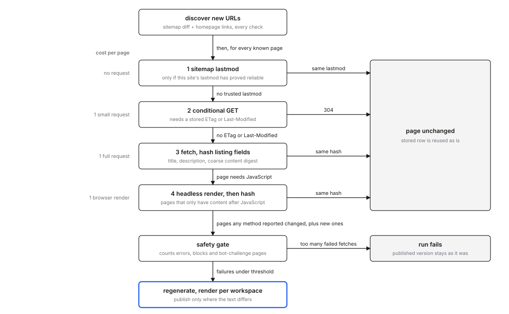

# System design

A web app that takes a website URL, generates an [llms.txt](https://llmstxt.org) for it, and keeps that file up to date as the site changes.

Status: the extractor, the crawler, the run lifecycle, the worker's run of the stages, the generator and the monitor's scheduling are implemented. The generator's LLM calls are wired in behind `ANTHROPIC_API_KEY`, but have not yet run against the live API; without a key the worker uses heuristics (see the [root README](../../README.md)). The schema in [`db/schema.sql`](../../db/schema.sql) is applied to Postgres 14 in CI on every PR ([`scripts/validate-schema.sh`](../../scripts/validate-schema.sh)).

## Contents

1. [System shape](#1-system-shape)
2. [Pipeline stages](#2-pipeline-stages)
3. [Data model](#3-data-model)
4. [Queueing and recovery](#4-queueing-and-recovery)
5. [Monitor](#5-monitor)
6. [Frontend](#6-frontend)
7. [Security and abuse limits](#7-security-and-abuse-limits)
8. [llms.txt output rules](#8-llmstxt-output-rules)
9. [Deliberately left out](#9-deliberately-left-out)
10. [Open questions](#10-open-questions)

## 1. System shape

Two processes and one database.

- **Web app:** the UI, the API, and the hosted `llms.txt` URL.
- **Worker:** runs the pipeline. Crawls take seconds to minutes, so they cannot live in a request handler.
- **Postgres:** the only stateful piece. It holds the tables and, through pg-boss, the job queue. The web app and worker never call each other directly.

The five components are the crawler, extractor, generator, monitor and frontend. The monitor has no pipeline of its own: it puts check jobs on the same queue, and they run through the same three stages as a first-time generation.

Stack: TypeScript throughout, Next.js for the web app, a Node worker with Playwright as the headless fallback, pg-boss for the queue, and node-postgres with hand-written SQL. Hosting is not decided; the proposal is Railway or Fly, as a web service, a worker service and Postgres.

## 2. Pipeline stages

Each stage has one typed input and one typed output, so each can be tested alone with fixtures.

A run is driven by the worker (`apps/worker/src/pipeline/run-pipeline-stages.ts`, one module per stage in `pipeline/stages/`) as load, decide, write. It loads the site and its stored pages, runs the stages, passes their output through pure decision functions, and saves what those return. The rules that are easiest to get wrong are those functions, tested without a database: `reconcilePage` (what a fetch does to a stored page, section 5), `evaluateSafetyGate`, `assessSitemapLastModifiedTrust` (in `packages/monitor`) and `decidePublication` (in `packages/generator`). Extraction happens inside the crawl: each page is extracted and saved as the crawler hands it over. So the UI states one of: queued, crawling, extracted (the crawl is done and the file is being generated), generated, or failed.

### Crawler

Owns all network I/O. It hands each fetched page (404s, 410s and 304s included, since the monitor needs them) to an `onPage` callback as soon as it has it, and waits for the callback, so the worker extracts and stores the page and the HTML is not held for the rest of the crawl. Then it returns a `CrawlResult`: the link signals that are only final once the crawl ends (navigation membership, inbound link counts), the fetches that failed with a typed reason (timeouts, 5xx, 429s, blocks), the robots.txt status, why the crawl stopped, and the site's rendering decision.

- **Root URL:** before a site's first crawl, the worker follows the homepage's redirect (`resolveSiteRootUrl`), obeying robots.txt. A move to another origin (`example.com` to `www.example.com`, `http` to `https`) becomes the site's `root_url`.
- **Discovery:** robots.txt, sitemaps, any existing llms.txt, and homepage navigation seed a prioritised breadth-first crawl under a page budget. Sitemaps come from robots.txt's `Sitemap:` lines, else `/sitemap.xml`, in every format the sitemaps protocol allows: XML, gzipped XML, plain text, RSS and Atom, up to 50 MB each. At most 10 sitemap files are read, and at most four sitemap URLs are kept per page of budget. llms.txt is looked for under the root URL, then at the host root. Its links usually point at `.md` variants, so they are mapped back to the HTML page. Within a depth, navigation links come first, then llms.txt, then sitemap, then other page links.
- **Navigation:** links inside `<nav>`, `<header>` or `role="navigation"` on the homepage. For each page they link, the crawler records the link's text (`navigation_label`, when it is 40 characters or fewer) and where the link comes among them (`navigation_position`). The generator uses the label to name a page or a section, and the position to keep the site's own order.
- **Conventions first:** where an open convention covers a behaviour (RFC 9309 for robots.txt, the sitemaps protocol, RFC 9110 for status codes and `Retry-After`, RFC 3986 for URLs, robots meta tags and `X-Robots-Tag`), the crawler follows it, and the choices below only fill the gaps.
- **Machine-readable files:** the site's own files for machines are listed beside its pages: `llms-full.txt`, an `llms.txt` for one part of the site, and an OpenAPI description (`openapi` or `swagger`, `.json` or `.yaml`). The crawler looks for `llms-full.txt` under the root URL, and takes any link to a file of those names from the site's llms.txt or from a page it reads. Each is requested once the pages are read, at most 20 a crawl, and kept if it answers 200 with something other than HTML, since an app shell answers every path. Only the first 64 KiB is read, and the content is not used. The files found are stored and requested again on every crawl, because a page that answers 304 has no links to find them by. A file is dropped when it no longer answers. If one answers with an error, or the crawl runs out of time, the crawl says it cannot tell and the stored list stands. The llms.txt at the site's root is not listed: the generated file stands in for it. An MCP server is not looked for, because nothing in a page reliably says where one is.
- **Known pages:** the worker passes the site's stored pages back in. Each is queued alongside what discovery finds, so a page nothing links to any more is still re-checked and its 404 is seen. A known page with an ETag or Last-Modified is fetched with a conditional GET, and a 304 is passed on with an empty body. On a site whose sitemap `lastmod` is trusted, a known page whose `lastmod` has not moved is not requested at all. The homepage is always fetched in full, because discovery starts from its links.
- **Which URL is requested:** the URL as the site linked it, with only RFC 3986's safe normalisation, and fragment and tracking parameters dropped. Rows are keyed on the more aggressive normalised URL (section 3), so `/about` and `/about/` are one page, but the crawler never requests a form the site did not link. The requested form is stored as `pages.fetch_url`, and a re-check asks for it.
- **Fetching, per site:** plain HTTP by default. On a site's first crawl the homepage is fetched both ways and compared, by visible text length and link count. If the browser finds much more (at least 200 more characters and 1.5 times the text, or links to 5 more pages of the site that are also half as many again as the plain HTML links), every page of the site is rendered. Links are counted as distinct pages in the crawl's scope, so a menu a script repeats, or a strip of links to other sites, does not make a server-rendered site pay for rendering. A homepage with no executable script skips the comparison. The answer is stored in `sites.requires_headless_rendering` and re-decided after 30 days.
- **Fetching, per page:** on a site that does not need rendering, a page whose plain HTML is empty, or holds an empty app mount point such as `
`, is rendered anyway. The rendered version is kept only if it shows more. This catches a client-rendered section of a server-rendered site. The crawler reads these signals itself, with a shallow parse, so it does not depend on the extractor.
- **Headless browser:** Chromium never touches the network. Every request it makes is intercepted and performed by Node through the same guarded connector as plain HTTP. Redirects are followed in Node too, because Chromium follows a redirect handed to it by interception without intercepting the next hop. See [Security](#7-security-and-abuse-limits). Rendering waits for network idle, then for the page text to stop changing, which catches content loaded after a timer.
- **robots.txt (RFC 9309):** rules for this crawler's token (`LlmsTxtGenerator`), else `*`. A 2xx robots.txt is parsed whatever its media type, up to its first 500 KiB. A 4xx, or more than five redirects, allows everything. A 5xx or an unreachable robots.txt means complete disallow: nothing else on the site is fetched, and the result says `robots_txt_unreachable` so the run can fail with that reason. The rules apply to every request the crawler makes on the site: pages, redirect targets, guessed sitemap and llms.txt locations, `.md` probes, and the headless browser's own requests. A redirect into a disallowed path is skipped, not counted as a failure. A redirect through the other scheme of the same host (`https` to `http` and back) is judged by the rules already read for that host. When the homepage itself is disallowed, or redirects into a disallowed path, and nothing else was fetched, the result says `homepage_disallowed_by_robots`. A related host's robots.txt is fetched once per crawl before its page is, and a host whose robots.txt cannot be reached is left alone. Not yet covered: the robots.txt of any other host is not fetched, so the browser's requests to a CDN and a redirect target on an unrelated host are made without checking them.
- **Robots directives:** `nofollow` and `noindex` from `<meta name="robots">`, `<meta name="LlmsTxtGenerator">` and `X-Robots-Tag` (unscoped, or scoped to this crawler). `nofollow` stops link discovery from that page. `noindex` is passed on as `has_noindex_directive`, and the generator leaves the page out.
- **Politeness:** requests to a site are sequential and at least 500 ms apart, or `Crawl-delay` apart if robots.txt sets one, honoured as given. A run stops taking new pages after 15 minutes, so a slow site gets fewer pages, not faster requests. A wait that would end past that limit stops the crawl instead of sleeping through it. A 429, or a 503 with `Retry-After`, is retried once after the wait (RFC 9110) when that is 30 seconds or less, and slows the rest of the crawl.
- **User agent:** `LlmsTxtGenerator/0.1`, whose product token is the one robots.txt groups match. By convention it should also link a page that explains the crawler; the worker should add that once the app is hosted.
- **Markdown variants:** probes for a `.md` version of each page (`index.html.md` for a URL without a file name), which the spec recommends linking in preference to HTML. Probing stops after three misses on a site that has none.
- **Scope:** only URLs under the site's `root_url`, on a path segment boundary. One exception: a page on another host of the same site that the homepage navigation links (`docs.example.com` from `www.example.com`) is fetched as a single page, under that host's own robots.txt, and its links are not followed. A site's most useful pages are often there. At most 15 per crawl. The site's domain is its host without a leading `www.`, so no public suffix list is needed; the cost is that a site at `docs.example.com` is not related to `blog.example.com`.
- **Meta refresh:** a page that sends the reader on within 5 seconds through `<meta http-equiv="refresh">` is a redirect written in HTML. Its target is queued in its place, keeping its depth and its place in the navigation, and the stub is not stored.
- **Known limitation:** hash-routed sites (`/#/docs`) are one page to the crawler, because fragments are dropped in normalisation and never reach the server. Such a site has nothing to list, so its run fails with that reason (section 5, Publishing).

### Extractor

A pure function from HTML to a `PageRecord`. No I/O, so it is tested against saved HTML fixtures.

- **Title:** Open Graph title, then the title tag, then the first H1, with two exceptions on inner pages. Where the title tag is a page name plus the site name the page declares (`Downloads | Acme`), that page name is used: the Open Graph title and the H1 are often a slogan or the homepage's title there. And many sites set the Open Graph title to the site name on every page, so where the title tag ends with it, the first H1 is used, then the title tag. A heading's permalink anchor (`Title¶`) is dropped.
- **Declared site name:** `og:site_name`, then a JSON-LD `WebSite` name, then `application-name`, when it is 60 characters or fewer.
- **Description:** meta description, then Open Graph description, then the first paragraph.
- **Page type:** one of `home`, `docs`, `api`, `guide`, `blog`, `product`, `pricing`, `about`, `legal`, `other`.
- **Language and canonical URL:** from `<html lang>` and `<link rel="canonical">`.
- **Page type rules:** the first URL path segment (or subdomain, as in `docs.`) that names a section decides; a docs section is narrowed by a later `api` or `guide` segment. A later legal segment makes a legal page (`/about/legal`), except in documentation and blogs, which write about anything (`/docs/cookies`). `help`, `support` and `faq` name a docs section only at the top of the site: `/foundation/faq` is one area's own page. Only when the URL says nothing do `og:type` and JSON-LD types count.
- **Content:** `<main>`, else the only top-level `<article>`, else the smallest element holding 80% of the page's prose (which finds content in client-rendered `
` markup), else `<body>` without nav, header, footer and aside. Converted to markdown with links made absolute against the final URL.
- **Hashes:** `content_digest` and `listing_fields_hash`, described under [Monitor](#5-monitor).

### Generator

- **Selection:** the file lists durable, structural pages that explain the site and how to use it, not its stream of content. Three steps. Deterministic filters first, so nothing is paid for pages that cannot be listed (below). Then the page assessment and the user's exclusions remove what does not belong. Last, pages are scored and one page per canonical URL is kept.
- **Deterministic filters:** the homepage (it is the H1) under any of its URLs, and any page serving the homepage's content; `noindex` pages; pagination (`/page/2`, `?page=2`); pages whose declared language differs from the homepage's (locale duplicates such as `/de/`); utility pages by URL (`login`, `signup`, `account`, `cart`, a last segment such as `create` or `search`, a `?next=` parameter); archive listings (`category`, `tag`, `author`, `archive`, a last segment `past`); what sits under a job board (`/jobs/...`, `/careers/...`); a page whose last segment is a number, unless the navigation links it or it is a blog post (the Blog limit handles those); and families of five or more sibling pages three or more path segments deep (`/downloads/release/...`), unless the navigation or the site's own llms.txt names them. The URL rules leave documentation alone, because it writes about logins and tags at URLs that say so. URL variants with the same content (`/guide`, `/guide.html`, `/guide.md`, `/guide/index.html`) count as one page.
- **Scoring:** navigation presence (4), nearness to the homepage (3 over one plus the crawl depth), inbound links (log2, capped at 3, because a sidebar that links every filter page from every listing page says nothing about them), a lift for pages the site's own llms.txt lists (2), less half a point per path segment beyond the first. Pages that score the same keep the order of the site's navigation, then the order in which the crawl first saw links to them (`first_link_position`), then of their URLs, comparing digit runs as numbers. On a site whose menu or sidebar holds every page, that order is what decides: a documentation site's pages all score the same, and its sidebar's order (installation before the reference) is better than the alphabet's. The crawl reads pages nearest the homepage first and links in the order they stand on a page, so the first sighting of each link follows the site's menus. The position is written by the first crawl that sees a link and kept, because a later check reads fewer pages (a 304 has no links) and an order that moved would republish an unchanged file. The cost is that a site that reorders its sidebar keeps the old order.
- **Page assessment:** Claude Haiku reads each candidate page and returns a one-line description, a listing value (`primary`, `optional` or `exclude`), a reason for any exclusion (`error_page`, `utility`, `thin`, `archive`, `individual_content`, `duplicate`) and a corrected page type. So a "not found" page served with a 200, a login page or a single blog post is left out. The model is told to choose `optional` when unsure.
- **Sections:** derived from the assessed page type (the extractor's when there is no assessment), in a fixed order: Docs, API, Guides, Product, Pricing, About, Blog. A page of type `other` goes in the section of its area of the site: when three or more such pages share a first path segment (`/community/...`), they get a section named by the navigation's label for that area's page, else by the segment in title case. Areas come after the fixed sections, the highest-scoring first. Remaining `other` pages go under Pages. The LLM picks among the page types but cannot create a section. Legal pages, a job board (when there is no assessment to say otherwise) and pages assessed `optional` go under `Optional`.
- **Limits:** at most 8 entries per section, 15 for Docs, API and Guides, 3 for Blog, 40 outside `Optional` and 15 under it. A page beyond a limit is left out, not moved: `Optional` holds pages that are secondary by nature. When the sections together hold more than 40, they are filled a round at a time (documentation sections two entries a round), so the limit cuts every section's tail. Beyond the ten highest-scoring pages, a page scoring under 3 is left out, so a large site's file does not fill up with pages hardly anything links, while a small site lists all it has. Documentation is exempt, because a docs page is often linked from its index alone. Starting values, in `packages/generator/src/select-pages.ts`.
- **Entries:** the `.md` variant when there is one, else the URL as the site links it. Descriptions are cut to 300 characters.
- **Site name:** the H1. First what the homepage declares. Else, when the homepage title also holds a tagline (`The guide – Acme`), the part that at least two other pages' titles share. Else the name at least half of the other pages' titles end or start with.
- **Entry titles:** the page's title without the site name at either end (`Docs | Acme` and `Acme | Docs` become `Docs`), without any other name two or more pages' titles end with (`| Acme Foundation`), and without the page's own host. When nothing is left, or what is left is the homepage's title, a sentence or longer than 80 characters, the entry takes the navigation's label for the page, then a title made from the URL in title case. Of entries that would share a title, the highest-scoring keeps it and the others take those alternatives.
- **Entry descriptions without an assessment:** text a site's templates repeat says nothing about a page. A meta description is dropped when it is the homepage's, when three or more pages with different content share it, or when it is a fragment of fewer than four words that does not end as a sentence. The entry then takes the first paragraph of prose in the page's content (not a heading, list, table, link or quotation, and ending as a sentence does), up to the sentence that passes 200 characters, on the same terms. Failing that it has no description, which is better than the same line on every entry.
- **Site summary:** Claude Opus writes it from the homepage and the listed pages. It is rewritten only when the homepage's title or description, or the titles of listed navigation pages, change, and the model is given its previous summary and told to keep the wording unless something is now wrong. So a new blog post does not reword it.
- **Notes:** the same call returns up to five one-line notes, which go under the summary. They are for what an assistant would get wrong from the summary and the links alone, and only for what the site itself states: a deprecated product and its replacement, two products that are easily confused, a requirement that applies to everything. The model is told that most sites need none, and to leave out guesses, its own advice, and version numbers, prices and dates, which would go stale while the cached notes stood. A note that repeats the summary or another note is dropped. They are cached on the summary's hash and passed back like the previous summary, so they do not come and go between runs.
- **Machine-readable files:** the files the crawler found go under an H2 named `Machine-readable resources`, after the page sections and before `Optional`. Each is titled by its path (`docs/llms.txt`) and described by its kind, the same words for every site, with no LLM involved. A user cannot exclude one.
- **LLM caching:** both results are stored against a hash of their inputs (including the model and prompt version) and never requested again for unchanged inputs, because an LLM words the same thing differently each time.
- **LLM failures:** the SDK retries transient errors. If the API is still unavailable, a page with an older assessment or a site with an older summary keeps it. A new page cannot be judged without one, so the run fails and the published file stays. A page the model refuses or answers unusably is left out and tried on the next run. Page text is passed as untrusted data, and output is forced to one line of plain text with links and markdown removed.
- **No API key:** for local development and tests only, the worker skips the LLM: candidate pages are listed with the description the crawl gives them (above), the summary is the homepage's description, and there are no notes.
- **Rendering:** deterministic, followed by validation against the spec. Output that fails validation is a bug, so it fails the run rather than being published.
- **Overrides:** the file is rendered with the site's overrides applied.

Still open: a site whose pages declare no language gets no locale filtering, and very large sites are only bounded by the page budget and the limits above.

## 3. Data model

The full DDL with comments is in [`db/schema.sql`](../../db/schema.sql).

| Table | Holds | Mutability |
|---|---|---|
| `sites` | One crawled website: root URL, cached summary and notes, machine-readable files found, monitor schedule | Updated in place |
| `pages` | Current state of each known URL of a site | Updated in place |
| `page_overrides` | The user's edits to individual pages | Updated in place |
| `pipeline_runs` | One execution of crawl, extract, generate for a site | Written during the run, then fixed |
| `llms_txt_versions` | Every published llms.txt of a site | Append-only |

### Design choices

- **Each submission is its own site.** Nothing is shared between submissions: submitting a URL twice makes two sites, each with its own crawl data, overrides, versions and schedule. This costs repeat crawls and LLM calls for a popular URL, and two submissions can crawl one host at the same time. In exchange, nobody can reach a file by submitting its URL.
- **One shared login, no accounts.** HTTP Basic auth (`apps/web/src/proxy.ts`) covers the web app and REST API. Anyone with the login can read and change every site. Only the hosted file is public, because a site's own `/llms.txt` proxies or redirects to it.
- **Column groups in `pages` have one writer each.** Crawler, extractor and generator each own a set of columns, so a stage can be re-run without clobbering another's output.
- **User edits are stored as inputs.** Overrides are applied by the generator on every run, so an edit survives regeneration. Only the description and an exclude flag can be overridden.
- **Rows are keyed on the normalised URL.** That is the URL after cleanup that needs no fetch: lowercase host, fragment and tracking parameters removed, query sorted, trailing slash stripped. The canonical URL a page declares is only known after fetching, so it is stored as a plain column and used to drop duplicates at selection.
- **Publishing is a single pointer update.** A version becomes live when `sites.published_version_id` moves to it. Choosing an older version is the same operation, and sets `is_published_version_pinned`: runs then still record new versions, compared with the newest version rather than the live one so nothing is recorded twice, but the pointer stays until the user unpins it and returns to the newest.
- **Raw HTML is not stored.** Only extracted markdown and hashes are kept. Improving the extractor means re-fetching pages.

### Where SQL lives

All SQL is hand-written in `packages/db`, one module per table, and the rest of the code calls its functions. ESLint stops any other package from importing `pg`, and stops contracts, the extractor, the generator and the crawler from importing the database at all: the worker loads their inputs and stores their outputs. A function whose writes must land with the caller's takes a `Transaction`, which only `withTransaction` produces, so it cannot be called on a bare pool by mistake.

## 4. Queueing and recovery

- **One job is one site's run.** Jobs are not split per page.
- **Concurrency:** the worker takes up to ten jobs at once, so ten sites run in parallel. Within a run, the target site is fetched at a per-host rate limit. Headless rendering has its own, lower, global limit because of memory: the worker shares one `HeadlessRenderer`, which runs at most two renders at once.
- **Priority:** a user's submission or "check now" is taken ahead of scheduled monitor checks.
- **One active run per site:** a partial unique index on `pipeline_runs` rejects a second queued or running run for the same site. "Check now" during a run joins it.
- **A run and its job are created together:** the `pipeline_runs` row is inserted and the pg-boss job sent in one transaction, through pg-boss's `db` option, and the job's id is the run's id. A crash can therefore never leave a queued row with no job, which would hold the site's slot for good. The web app and the monitor both go through one function, `startPipelineRun`, so priorities and queue options are set in one place.
- **Guarded status changes:** `queued → running → succeeded | unchanged | failed`, and `queued | running → failed` by the reaper. Every change is a conditional update that names the status it expects. A job that cannot claim its run (already claimed, or reaped) is dropped. A worker that finishes after its run was reaped records nothing, and publishing first locks the run row and checks that the run is still running.
- **Heartbeat:** a running job updates `last_heartbeat_at` every 5 seconds.
- **Reaper:** every monitor tick, fails running rows whose heartbeat is over 2 minutes old and queued rows over 6 hours old (a job that failed or expired before it was claimed). Either frees the site for a new run.
- **No queue-level retries:** pipeline-run jobs have `retryLimit: 0`. A retried job would find its run already failed by the reaper, so retries would only add a second recovery path that disagrees with the first. A failed run is retried by the next monitor check or by the user. pg-boss expiry (45 minutes, well past the longest run) only cleans up after a worker that died.

`pipeline_runs` is the record of a run: its status and stage, which the frontend polls, and counters for the audit log. pg-boss only decides when and where a job runs.

## 5. Monitor

A check runs on a fixed interval per site (default 7 days) or when a user presses "check now". A site is only scheduled while its monitoring is unexpired.

### Scheduling

The monitor only acts on a schedule. A request to check now arrives over HTTP, so the web app takes it and queues the run itself, through the same `startPipelineRun`. The two never call each other.

- **Starting and renewing:** every submission turns monitoring on for 30 days and users cannot turn it off. "Check now" renews it for 30 days, including after it has lapsed. If the site has no check scheduled, it gets one a full interval out: the site was just crawled, so checking sooner would find nothing.
- **Deleting a site:** removes its pages, overrides, runs, versions and hosted file. A run in progress loses its row, so its next write fails and it cannot publish.
- **The tick:** every 5 minutes, a pg-boss cron job in the worker reaps stale runs (section 4). Then it claims up to 100 due sites, skipping rows another tick has locked, moves each one's next check on by its interval, and queues a monitor run behind user requests. A due site whose monitoring has lapsed is unscheduled at that point, so expiry needs no job of its own.
- **Check now:** the same pipeline as a scheduled check, queued ahead of scheduled checks. A run already in progress is joined. Otherwise the site is checked at most once per 5 minutes, counted from its last run of any kind.

### Change detection

Discovery runs on every check to find new URLs. Then every known page is checked by the first method it supports:

| Order | Method | Used when | Cost per page |
|---|---|---|---|
| 1 | Sitemap `lastmod` | The site's `lastmod` has proved reliable (`sites.sitemap_lastmod_is_trusted`) | No request |
| 2 | Conditional GET | The page has a stored ETag or Last-Modified | One small request |
| 3 | Fetch and hash | Neither of the above | One full request |
| 4 | Headless render and hash | The page only has content after JavaScript runs | One browser render |

### What counts as a change

The change signal is `listing_fields_hash`: a hash of what feeds the page's llms.txt entry. That is the extracted title and description plus `content_digest`, because the entry's description is written from the content. `content_digest` hashes headings and body text with dates, numbers and whitespace stripped, so "updated 3 days ago" is not a change.

### Pages that go missing

| What the check sees | What happens |
|---|---|
| The page's URL returns 404 or 410 once | `consecutive_not_found_count` becomes 1; the page stays listed |
| It returns 404 or 410 on the next check too | `removed_at` is set and the page is dropped from the file; the row is kept so overrides survive |
| It still loads but is gone from the sitemap and navigation | Not removed; the score computed at selection falls, so it may move to `## Optional` or below the cut-off |
| The fetch fails (timeout, 5xx, blocked) | The stored row is reused; the failure counts toward the safety gate |
| A removed page returns 200 again | The counter resets, `removed_at` is cleared, and it is listed again |

A page is never removed because a crawl failed to reach it.

### Safety gate

Failed fetches include errors, blocks (401, 403, 451) and bot-challenge pages. If they are over half of the run's fetches, or nothing could be fetched, or no page returned content (a site-wide 404, say), or robots.txt was unreachable or rules out the homepage, the run fails and the published version is left alone. Pages fetched successfully are saved as they arrive, because those facts hold either way. 404 and 410 responses are held back until the run passes the gate, so a failed run never counts toward removing a page.

### Trusting sitemap `lastmod`

A page fetched in full that has both an old and a new `lastmod`, and an old and a new content digest, is one observation. A single page whose content changed while its `lastmod` did not withdraws trust. Trust is given once a run has at least five observations, no misses, and at least one content change that its `lastmod` flagged.

### Publishing

Entries are regenerated only for changed pages. A new version is written only where the text differs from the site's newest version.

A site with nothing to list besides its homepage publishes nothing: the run fails and says why. A file that is only a name and a summary usually means the crawl could not get past the homepage (a single-page app, hash routing, a login wall, an app that crashed in the browser). The rule is for a site's first file. A site that has published before is let through, so a file whose last page went on its own 404s loses that link instead of keeping it.

## 6. Frontend

- **Generate:** URL input, then the run's status polled from `pipeline_runs`: crawling, extracted, generated.
- **Result:** rendered preview next to raw text, spec validation status, copy and download.
- **Editing:** override a page's description or exclude a page.
- **Site link:** `/w/{public_slug}`. The browser keeps the sites it created so the home page can show them as a table with each one's latest status. Submitting a site opens its details page.
- **API (HTTP Basic auth):** a REST API that the web app also uses, documented in the [root README](../../README.md#rest-api). A submission creates a site. A run has its own status, and a file is reached by version number or by the run that published it. A run that published nothing answers 404 with the code `run_produced_no_version`, rather than some other run's file. Errors carry a stable `code` beside the human-readable `error`.
- **Hosted URL:** a stable `/w/{public_slug}/llms.txt`. The spec puts llms.txt at the site's own root, so the site owner redirects or proxies to this URL. The [root README](../../README.md#serving-llmstxt-from-your-own-domain) explains how.
- **Monitoring:** on for every site with an expiry, a "check now" button that renews it, and version history with diffs: the user picks any two versions and sees a line diff, computed in the browser.
- **Versions:** a list of versions with counts of pages added, removed and changed, from which the user makes one live and pins it, or returns to following the latest.

## 7. Security and abuse limits

The app is public, has no accounts, and fetches URLs that users supply.

- **SSRF guard:** blocks private, loopback and link-local addresses, including IPv6 and IPv4-mapped forms and the hosting platform's private network. It runs inside the HTTP client's connector: the host is resolved there, every address is checked, and the socket connects to the checked address, so there is no second lookup for DNS rebinding to exploit. A host with any blocked address is refused. Redirects are followed by hand, and each hop opens a new, checked connection. It covers the headless browser by performing every browser request in Node through the same connector. As a second layer, the browser's own DNS is disabled, so a request that escaped interception could not reach anything. WebSockets, service workers and popups are refused.
- **Network policy:** the guard's rule is passed in when the fetcher is created. Production uses the public-internet-only policy. End-to-end tests pass one that allows only their fixture sites' loopback ports; it lives in the tests, and no setting or environment variable can loosen the guard.
- **Fetch limits:** 15 seconds per fetch including redirects, 5 MB per response, 5 redirects, and only `http` and `https`; a page budget per run. A response of a type the caller did not ask for is dropped without reading its body.
- **Submission limits:** a per-IP rate limit using `sites.creator_ip_hash` (10 new sites per hour by default), and a global concurrency cap from the queue. The IP is read from the right of `X-Forwarded-For`, counting back `TRUSTED_PROXY_HOPS` entries (default 1), because a client can put anything in the entries to the left. This needs the app to sit behind the hosting platform's proxy.
- **Monitor expiry:** `monitoring_enabled_until` stops abandoned submissions from being re-crawled forever.
- **Check-now cooldown:** a site is checked by hand at most once per 5 minutes, so nobody can keep a site under constant crawling. The active-run index already stops parallel crawls, but not back-to-back ones.
- **Login:** HTTP Basic auth on every path except the hosted file and Next's static assets, compared in constant time. The username and password come from `BASIC_AUTH_USERNAME` and `BASIC_AUTH_PASSWORD`, defaulting to `user1` and `pass1`, which are public, so a deployment must set its own. Basic auth sends the password with each request, so a deployment needs HTTPS.
- **Served files:** `text/plain` with `X-Content-Type-Options: nosniff`.
- **Preview:** crawled titles and descriptions are untrusted and are escaped before display.

## 8. llms.txt output rules

Checked against llmstxt.org.

- **Order:** H1 with the site name (the only required part), a blockquote summary, optional notes as a plain list with no headings, then H2 sections of links.
- **Headings:** only H1 and H2. No H3 sub-grouping.
- **Entries:** `- [title](url): description`, each on one line.
- **Escaping:** square brackets in titles are escaped, newlines are stripped, parentheses in URLs are encoded, and LLM output is forced to a single line.
- **Optional section:** lower-priority pages go under an H2 named exactly `Optional`, which the spec defines as skippable.
- **Markdown links:** where a page has a `.md` variant, the entry links that.
- **Machine-readable files:** the site's own `llms-full.txt`, section `llms.txt` files and OpenAPI descriptions are entries like any other, under their own H2.

## 9. Deliberately left out

| Left out | Why |
|---|---|
| User accounts | One shared HTTP Basic login covers the app without sessions or a user table |
| Webhook and email notifications | Both are open relays on an app without accounts |
| Adaptive check interval | A fixed interval plus "check now" is simpler and easier to demonstrate |
| Generating an `llms-full.txt` | Not found in the spec; it would duplicate large content per version. A site's own is linked when it has one |
| Notes written by the site's owner | Overrides are limited to description and exclude; the notes are the LLM's, from what the site states |
| Server-sent events | Polling `pipeline_runs` is enough for run status |
| LLM-invented sections, and title, summary and section overrides | Sections come from the assessed page type and, for pages of no type, from the site's own URL areas and navigation labels; overrides are limited to description and exclude |
| Raw HTML storage | Saved fixtures cover extractor testing |
| A separate queue broker | pg-boss in Postgres handles this load without another service |

## 10. Open questions

Not yet decided or designed.

- **Hosting:** Railway or Fly is proposed, not decided.
- **Redirects:** a page that now returns a permanent redirect is not handled, and neither is a site with stored pages whose homepage moves to another origin (its runs fail and the published file stays). Proposal: treat it as an immediate removal of the old URL and add the target as a page if it is in scope. Needs one new column on `pages` for the redirect target.
- **Soft 404s:** sites that answer a deleted URL with 200 and a "not found" body are not handled. Proposal: an extractor check that counts the same as a real 404.
- **Slow removal:** with a 7-day interval, waiting for two checks can leave a dead link in the file for two weeks. Proposal: schedule a follow-up check 24 hours after any run that sees a first 404.
- **Stale sitemap:** if `lastmod` is trusted and a deleted page is still listed with an unchanged date, no request is made and the deletion is missed.
- **Page selection:** the rules in section 2 have been tuned against one real site (python.org, without an API key); locale duplicates without a declared language are not handled, and the limits and the assessment prompt are otherwise untested against real sites. The URL rules for utility and archive pages are English-only.
- **Related hosts:** a stored page on a related host that the navigation no longer links is still re-checked, but nothing removes it short of its own 404. A related host is told from the site's host alone, so `blog.example.com` is not related to a site at `docs.example.com`.
- **Meta refresh:** a stored page that becomes a meta-refresh stub is neither updated nor removed; its target is crawled as a new page.
- **Restoring an excluded page:** a user cannot yet force back a page the assessment wrongly excluded.
- **Partial link counts:** a page answered with a 304, or skipped because of a trusted `lastmod`, has no body, so its links are not seen. On such runs, inbound link counts and the frontier miss those links.
- **Thresholds:** the page budget (200, `CRAWL_PAGE_BUDGET`) and the safety-gate failure share (0.5) have starting values that have not been tuned against real sites. The headless thresholds have starting values in `packages/crawler/src/page-signals/render-decision.ts`, tuned only against the fixture sites.
