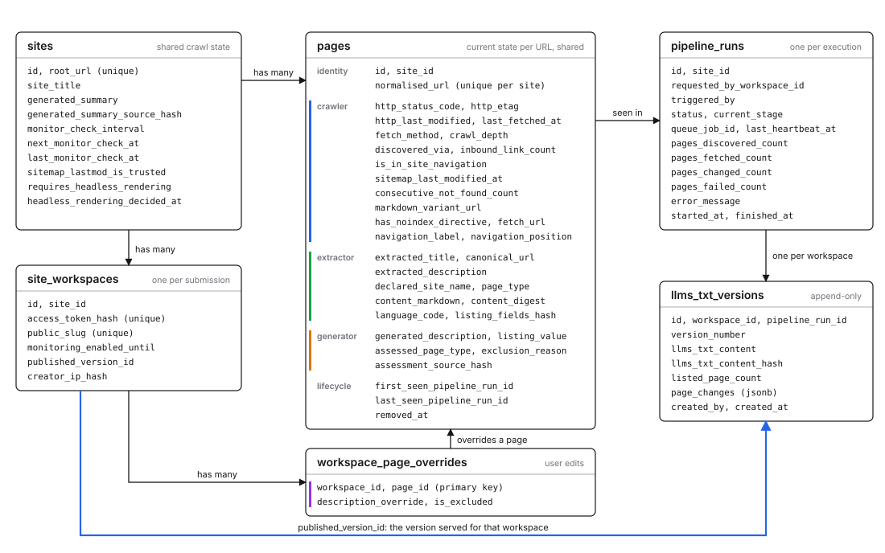

# System design

A web app that takes a website URL, generates an [llms.txt](https://llmstxt.org) for it, and keeps that file up to date as the site changes.

Status: project skeleton. Every component exists as a package with typed stubs (see the [root README](../../README.md)); no pipeline logic is implemented yet. The schema in [`db/schema.sql`](../../db/schema.sql) is applied to Postgres 14 in CI on every PR ([`scripts/validate-schema.sh`](../../scripts/validate-schema.sh)).

## Contents

1. [System shape](#1-system-shape)
2. [Pipeline stages](#2-pipeline-stages)
3. [Data model](#3-data-model)
4. [Queueing and recovery](#4-queueing-and-recovery)
5. [Monitor](#5-monitor)
6. [Frontend](#6-frontend)
7. [Security and abuse limits](#7-security-and-abuse-limits)
8. [llms.txt output rules](#8-llmstxt-output-rules)
9. [Deliberately left out](#9-deliberately-left-out)
10. [Open questions](#10-open-questions)

## 1. System shape

Two processes and one database.

- **Web app:** the UI, the API, and the hosted `llms.txt` URL.
- **Worker:** runs the pipeline. Crawls take seconds to minutes, so they cannot live in a request handler.
- **Postgres:** the only stateful piece. It holds the tables and, through pg-boss, the job queue. The web app and worker never call each other directly.

The five components are the crawler, extractor, generator, monitor and frontend. The monitor has no pipeline of its own: it puts check jobs on the same queue, and they run through the same three stages as a first-time generation.

Stack: TypeScript throughout, Next.js for the web app, a Node worker with Playwright as the headless fallback, pg-boss for the queue, and node-postgres with hand-written SQL. Hosting is not decided; the proposal is Railway or Fly, as a web service, a worker service and Postgres.

## 2. Pipeline stages

Each stage has one typed input and one typed output, so each can be tested alone with fixtures.

### Crawler

Owns all network I/O.

- **Discovery:** robots.txt, sitemaps, any existing llms.txt, and homepage navigation seed a prioritised breadth-first crawl under a page budget.
- **Fetching:** plain HTTP first. The headless browser is used only when a page's extracted text length and link count fall below a threshold, which is the sign of a JavaScript-rendered page.
- **Politeness:** obeys robots.txt and applies a per-host rate limit.
- **Markdown variants:** probes for a `.md` version of each page, which the spec recommends linking in preference to HTML.
- **Scope:** only URLs under the site's `root_url`.

### Extractor

A pure function from HTML to a `PageRecord`. No I/O, so it is tested against saved HTML fixtures.

- **Title:** Open Graph title, then the title tag, then the first H1.
- **Description:** meta description, then Open Graph description, then the first paragraph.
- **Page type:** one of `home`, `docs`, `api`, `guide`, `blog`, `product`, `pricing`, `about`, `legal`, `other`.
- **Content:** main content converted to markdown.
- **Hashes:** `content_digest` and `listing_fields_hash`, described under [Monitor](#5-monitor).

### Generator

- **Selection:** scores pages on navigation presence, crawl depth and inbound links, then drops duplicates that share a canonical URL.
- **Sections:** derived from `page_type`. The LLM does not choose sections.
- **LLM use:** writes the site summary, and a description only for pages that have no usable one of their own. Both are cached, because an LLM words the same thing differently each time. If the LLM is unavailable, heuristics are used and the file is still valid.
- **Rendering:** deterministic, followed by validation against the spec.
- **Per workspace:** the file is rendered once per workspace, applying that workspace's overrides.

Page selection needs explicit handling for very large sitemaps, locale duplicates such as `/en/` and `/de/`, floods of blog posts, and pagination. This is not designed in detail yet.

## 3. Data model

The full DDL with comments is in [`db/schema.sql`](../../db/schema.sql).

| Table | Holds | Mutability |
|---|---|---|
| `sites` | One crawled website: root URL, cached summary, monitor schedule | Updated in place |
| `site_workspaces` | One submission of a site: access token, hosted slug, published version | Updated in place |
| `pages` | Current state of each known URL of a site | Updated in place |
| `workspace_page_overrides` | A workspace's edits to individual pages | Updated in place |
| `pipeline_runs` | One execution of crawl, extract, generate for a site | Written during the run, then fixed |
| `llms_txt_versions` | Every published llms.txt of a workspace | Append-only |

### Design choices

- **Crawl state is shared, ownership is not.** A site has many workspaces. A second person submitting the same site reuses the crawl and gets their own workspace, token and overrides.
- **No user accounts.** Each submission returns a secret link containing a random token. Holding the link authorises editing that workspace. Only the token's SHA-256 is stored.
- **Column groups in `pages` have one writer each.** Crawler, extractor and generator each own a set of columns, so a stage can be re-run without clobbering another's output.
- **User edits are stored as inputs.** Overrides are applied by the generator on every run, so an edit survives regeneration. Only the description and an exclude flag can be overridden.
- **Rows are keyed on the normalised URL.** That is the fetched URL after cleanup that needs no fetch: lowercase host, fragment and tracking parameters removed, query sorted, trailing slash stripped. The canonical URL a page declares is only known after fetching, so it is stored as a plain column and used to drop duplicates at selection.
- **Publishing is a single pointer update.** A version becomes live when `site_workspaces.published_version_id` moves to it. Rollback is the same operation.
- **Raw HTML is not stored.** Only extracted markdown and hashes are kept. Improving the extractor means re-fetching pages.

## 4. Queueing and recovery

- **One job is one site's run.** Jobs are not split per page.
- **Concurrency:** the worker takes up to ten jobs at once, so ten sites run in parallel. Within a run, the target site is fetched at a per-host rate limit. Headless rendering has its own, lower, global limit because of memory.
- **Priority:** a user's submission or "check now" is taken ahead of scheduled monitor checks.
- **One active run per site:** a partial unique index on `pipeline_runs` rejects a second queued or running run for the same site.
- **Heartbeat:** a running job updates `last_heartbeat_at` every few seconds.
- **Reaper:** marks any running row with a stale heartbeat as failed, which frees that site for a new run.
- **Queue-level recovery:** pg-boss job expiry and retry cover a worker that dies mid-job.

`pipeline_runs` records what a job did and feeds the progress the frontend polls. pg-boss decides when and where a job runs.

## 5. Monitor

A check runs on a fixed interval per site (default 7 days) or when a user presses "check now". A site is only scheduled while at least one of its workspaces has unexpired monitoring.

### Change detection

Discovery runs on every check to find new URLs. Then every known page is checked by the first method it supports:

| Order | Method | Used when | Cost per page |
|---|---|---|---|
| 1 | Sitemap `lastmod` | The site's `lastmod` has proved reliable (`sites.sitemap_lastmod_is_trusted`) | No request |
| 2 | Conditional GET | The page has a stored ETag or Last-Modified | One small request |
| 3 | Fetch and hash | Neither of the above | One full request |
| 4 | Headless render and hash | The page only has content after JavaScript runs | One browser render |

### What counts as a change

The change signal is `listing_fields_hash`: a hash of what feeds the page's llms.txt entry. That is the extracted title and description, plus `content_digest` only when the page has no usable description of its own. `content_digest` hashes headings and body text with dates, numbers and whitespace stripped, so "updated 3 days ago" is not a change.

### Pages that go missing

| What the check sees | What happens |
|---|---|
| The page's URL returns 404 or 410 once | `consecutive_not_found_count` becomes 1; the page stays listed |
| It returns 404 or 410 on the next check too | `removed_at` is set and the page is dropped from the file; the row is kept so overrides survive |
| It still loads but is gone from the sitemap and navigation | Not removed; its importance score falls, so it may move to `## Optional` or below the cut-off |
| The fetch fails (timeout, 5xx, blocked) | The stored row is reused; the failure counts toward the safety gate |
| A removed page returns 200 again | The counter resets, `removed_at` is cleared, and it is listed again |

A page is never removed because a crawl failed to reach it.

### Safety gate

Failed fetches include errors, blocks and bot-challenge pages. If they exceed a threshold share of the run, the run fails and the published version is left alone.

### Publishing

Entries are regenerated only for changed pages. The file is rendered per workspace, and a new version is written only where the text differs from that workspace's published version.

## 6. Frontend

- **Generate:** URL input, then progress polled from `pipeline_runs` (pages discovered, fetched, changed).
- **Result:** rendered preview next to raw text, spec validation status, copy and download.
- **Editing:** override a page's description or exclude a page.
- **Hosted URL:** a stable `/w/{public_slug}/llms.txt`. The spec puts llms.txt at the site's own root, so the site owner redirects or proxies to this URL. The README has to explain how.
- **Monitoring:** opt-in per workspace with an expiry, a "check now" button, and version history with diffs.

## 7. Security and abuse limits

The app is public, has no accounts, and fetches URLs that users supply.

- **SSRF guard:** blocks private, loopback and link-local addresses, including IPv6 and IPv4-mapped forms and the hosting platform's private network. It is applied again after every redirect, and the resolved IP is pinned to defeat DNS rebinding. It must cover the headless browser as well as the HTTP client.
- **Fetch limits:** response size and time caps on every fetch; a page budget per run.
- **Submission limits:** a per-IP rate limit using `site_workspaces.creator_ip_hash`, and a global concurrency cap from the queue.
- **Monitor expiry:** `monitoring_enabled_until` stops abandoned submissions from being re-crawled forever.
- **Served files:** `text/plain` with `X-Content-Type-Options: nosniff`.
- **Preview:** crawled titles and descriptions are untrusted and are escaped before display.

## 8. llms.txt output rules

Checked against llmstxt.org.

- **Order:** H1 with the site name (the only required part), a blockquote summary, optional body text with no headings, then H2 sections of links.
- **Headings:** only H1 and H2. No H3 sub-grouping.
- **Entries:** `- [title](url): description`, each on one line.
- **Escaping:** square brackets in titles are escaped, newlines are stripped, parentheses in URLs are encoded, and LLM output is forced to a single line.
- **Optional section:** lower-priority pages go under an H2 named exactly `Optional`, which the spec defines as skippable.
- **Markdown links:** where a page has a `.md` variant, the entry links that.

## 9. Deliberately left out

| Left out | Why |
|---|---|
| User accounts | A secret link per workspace covers editing without the work of auth |
| Webhook and email notifications | Both are open relays on an app without accounts |
| Adaptive check interval | A fixed interval plus "check now" is simpler and easier to demonstrate |
| `llms-full.txt` | Not found in the spec; it would duplicate large content per version |
| Server-sent events | Polling `pipeline_runs` is enough for progress |
| LLM-chosen sections, and title, summary and section overrides | Sections come from page type; overrides are limited to description and exclude |
| Raw HTML storage | Saved fixtures cover extractor testing |
| A separate queue broker | pg-boss in Postgres handles this load without another service |

## 10. Open questions

Not yet decided or designed.

- **Hosting:** Railway or Fly is proposed, not decided.
- **Redirects:** a page that now returns a permanent redirect is not handled. Proposal: treat it as an immediate removal of the old URL and add the target as a page if it is in scope. Needs one new column on `pages` for the redirect target.
- **Soft 404s:** sites that answer a deleted URL with 200 and a "not found" body are not handled. Proposal: an extractor check that counts the same as a real 404.
- **Slow removal:** with a 7-day interval, waiting for two checks can leave a dead link in the file for two weeks. Proposal: schedule a follow-up check 24 hours after any run that sees a first 404.
- **Stale sitemap:** if `lastmod` is trusted and a deleted page is still listed with an unchanged date, no request is made and the deletion is missed.
- **Page selection:** rules for large and awkward sites, as noted in section 2.
- **Thresholds:** the page budget, the headless trigger threshold and the safety-gate failure share have no values yet.
